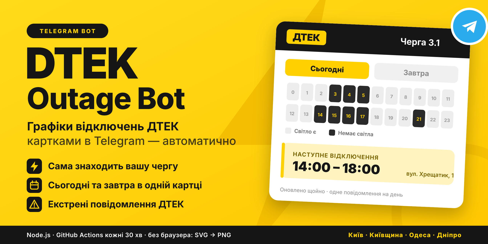
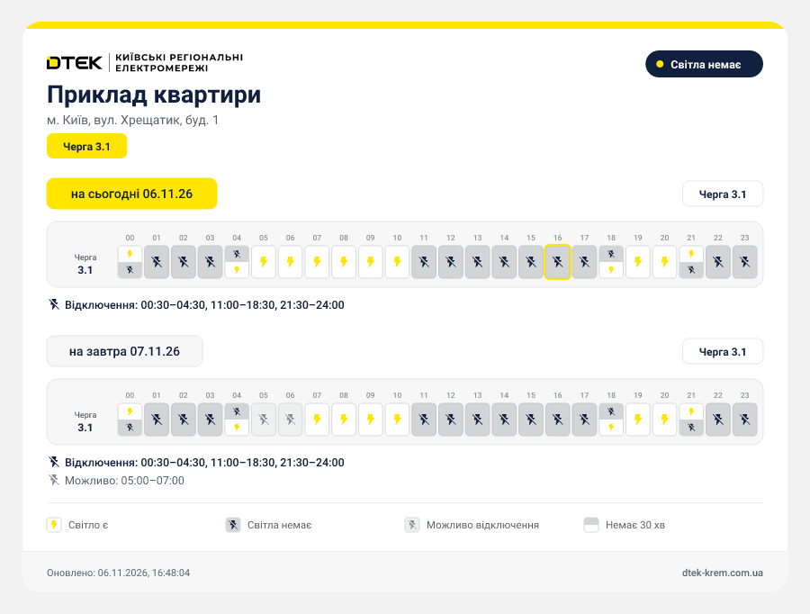

<div align="center">



# ⚡ DTEK Outage Bot

> ⚠️ **Unofficial project, not affiliated with DTEK.** Uses public data and DTEK API for personal monitoring purposes.

[](https://core.telegram.org/bots)
[](https://nodejs.org/)
[](LICENSE)

**[Українська версія →](README.md)**

</div>

---

## 📖 Overview

A Telegram bot for autonomous monitoring of power outage schedules provided by DTEK (**KREM, KEM, OEM, DNEM** — Kyiv region, Kyiv city, Odesa, and Dnipro regions). Primary testing is focused on KREM; support for other regions via `DTEK_URL` is experimental. The bot automatically checks schedules for specified addresses, generates high-quality PNG cards, and posts them to designated Telegram forum topics (message threads) without spamming the chat.

---

## 📸 Work Example

<div align="center">
  
  <p><i>The generated PNG card (sample neutral address) sent by the bot to Telegram</i></p>
</div>

---

## ✨ Features

- 🔌 **Auto queue resolution** — the bot finds the correct outage queue (e.g., `Queue 3.1`) for each house automatically.
- 📅 **Two dates in one card** — "today" and "tomorrow"; if tomorrow's schedule isn't published yet, it says so explicitly.
- 🚨 **Emergency & stabilization alerts** — picked up automatically from the DTEK site's modal dialog.
- 💡 **DTEK visual style** — logo, yellow date pills, grey cells with icons, and a clear legend.
- 🚫 **No browser for rendering** — SVG is built in code and converted to PNG via `@resvg/resvg-js`. Playwright is used **only as a fallback transport** for fetching if Incapsula blocks plain HTTP.
- 🔁 **One active message per day** — posts only 1 active message per day; if the schedule changes during the day, the previous message is deleted and a new one is sent (keeping the chat clean while triggering a fresh push notification).
- 🌙 **Silent night mode** — no notification sounds between 22:00–08:00 Kyiv time.

---

## 🚀 Quick start

### Local

```bash
git clone https://github.com/mrdillmax/dtek-telegram-bot.git
cd dtek-telegram-bot
cp .env.example .env
npm install
npm start
```

### GitHub Actions (Recommended)

Runs automatically every 30 minutes in the cloud:

1. Add repository secrets (`Settings → Secrets and variables → Actions`):
   - `TELEGRAM_BOT_TOKEN`
   - `TELEGRAM_CHAT_ID`
   - `TARGETS`
2. Workflow `.github/workflows/checker.yml` will run on schedule.

---

## ⚙️ Configuration

> ⚠️ **Security Warning:** Since the repository is public, **never commit** real addresses or tokens into open code! Use a local `.env` file (ignored by Git) or GitHub Actions Secrets.

`.env` file:

```env
TELEGRAM_BOT_TOKEN=your_token
TELEGRAM_CHAT_ID=-1001234567890
TARGETS=[...json...]
DTEK_BROWSER_FALLBACK=false
# Optional: monitor another region (default is Kyiv Region — KREM)
# DTEK_URL=https://www.dtek-kem.com.ua/ua/shutdowns  (Kyiv City)
# DTEK_URL=https://www.dtek-oem.com.ua/ua/shutdowns  (Odesa Region)
# DTEK_URL=https://www.dtek-dnem.com.ua/ua/shutdowns (Dnipro Region)
```

`TARGETS` format:

```json
[
  {
    "id": "address_1",
    "name": "Apartment",
    "city": "м. Київ",
    "street": "вул. Хрещатик",
    "house": "1",
    "thread_id": 10
  }
]
```

---

## ❓ FAQ

### ❌ Error "Telegram: chat not found"
**Solution:** Add the bot to your supergroup, grant send permissions, and ensure `TELEGRAM_CHAT_ID` starts with `-100`.

### 🛡️ DTEK blocks requests (Incapsula / 403 Forbidden)
**Solution:** The bot will automatically fallback to Playwright. If running locally, install it: `npx playwright install chromium`.

### 🧵 How to find `thread_id` for a topic?
**Solution:** Post any message in the desired thread and run `npm run chat-id`. The bot will list all active topic IDs.

### 🔄 Why does the bot delete old messages?
To ensure there is only one up-to-date message per day. If a schedule changes, the old message is deleted to prevent spam, and a new one is posted to trigger a notification.

### ⏸️ The bot suddenly stopped running via GitHub Actions
**Reason:** Per GitHub policy, scheduled workflows in public repositories are automatically paused after **60 days of inactivity** (no commits or pushes).
**Solution:** Go to the **Actions** tab on GitHub and click **Enable workflow** (or push a small commit).

---

## 🏗️ How it works

1. **Fetch** — HTTP request without browser → (`DisconSchedule.fact` + AJAX `getHomeNum`).
2. **Resolve** — finds the correct queue for the address.
3. **Render** — SVG card → PNG via `@resvg/resvg-js`.
4. **Send** — `sendPhoto` with `message_thread_id` or `editMessageCaption`.

---

## 📄 License

MIT
