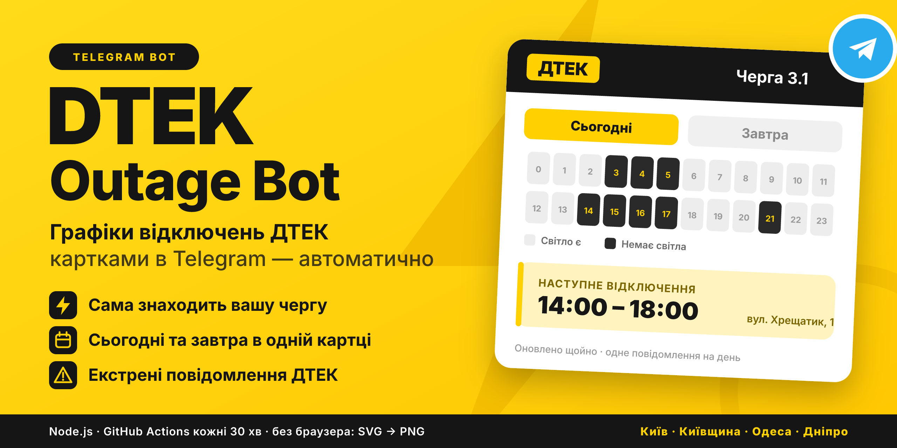
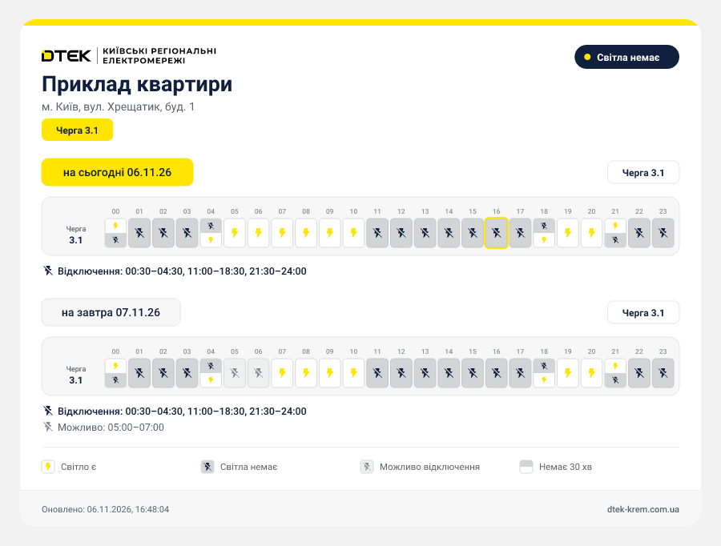

<div align="center">



# ⚡ DTEK Outage Bot

> ⚠️ **Неофіційний проєкт, не пов'язаний з ДТЕК.** Використовує публічні дані та API ДТЕК виключно для особистого моніторингу.

[](https://core.telegram.org/bots)
[](https://nodejs.org/)
[](LICENSE)

**[English version →](README.en.md)**

</div>

---

## 📖 Огляд

Telegram-бот для автоматичного моніторингу графіків відключень електроенергії ДТЕК (**KREM, KEM, OEM, DNEM** — Київська обл., Київ, Одещина, Дніпропетровщина). Основне тестування проводилось на KREM; підтримка інших регіонів (`DTEK_URL`) є експериментальною. Бот самостійно перевіряє графіки за вказаними адресами, генерує гарні PNG-картки та надсилає їх у відповідні гілки (Topics) Telegram-чату без зайвого спаму.

---

## 📸 Приклад картки

<div align="center">
  
  <p><i>Згенерована PNG-картка (нейтральний приклад адреси), яку бот надсилає в Telegram</i></p>
</div>

---

## ✨ Можливості

- 🔌 **Автоматичне визначення черги** — бот самостійно знаходить потрібну чергу (наприклад, `Черга 3.1`) для кожного будинку.
- 📅 **Дві дати в одній картці** — «сьогодні» та «завтра» (якщо завтрашній графік ще не опубліковано, це чітко вказано).
- 🚨 **Екстрені та стабілізаційні повідомлення** — автоматично підтягуються з модального вікна сайту ДТЕК.
- 💡 **Фірмовий стиль ДТЕК** — логотип, жовті вкладки дат, сірі клітинки з іконками та легенда.
- 🚫 **Без браузера для рендерингу** — SVG будується в коді та конвертується у PNG через `@resvg/resvg-js`. Playwright/Chromium залучається **лише як резервний транспорт** на етапі мережевого запиту, якщо Incapsula блокує прямий HTTP.
- 🔁 **Одне повідомлення на день (без спаму)** — бот тримає в чаті лише 1 актуальне повідомлення. Якщо графік оновлюється протягом дня, попереднє повідомлення автоматично видаляється і надсилається нове (з приходом свіжого пуш-сповіщення).
- 🌙 **Тихий режим** — у нічний час (22:00–08:00 за Києвом) повідомлення надсилаються без звуку.

---

## 🚀 Швидкий старт

### Локально

```bash
git clone https://github.com/mrdillmax/dtek-telegram-bot.git
cd dtek-telegram-bot
cp .env.example .env
npm install
npm start
```

### GitHub Actions (Рекомендовано)

Бот може працювати повністю автоматично у хмарі кожні 30 хвилин:

1. Додайте секрети репозиторію (`Settings → Secrets and variables → Actions`):
   - `TELEGRAM_BOT_TOKEN`
   - `TELEGRAM_CHAT_ID`
   - `TARGETS`
2. Workflow `.github/workflows/checker.yml` почне перевірку за розкладом.

---

## ⚙️ Конфігурація

> ⚠️ **Важливо безпеки:** Оскільки репозиторій публічний, **ніколи не комітьте** свої реальні адреси або токени у відкритий код! Використовуйте локальний файл `.env` (він автоматично в ігнорі Git) або закриті секрети GitHub Actions (`Secrets`).

Файл `.env`:

```env
TELEGRAM_BOT_TOKEN=your_token
TELEGRAM_CHAT_ID=-1001234567890
TARGETS=[...json...]
DTEK_BROWSER_FALLBACK=false
# Опціонально: інша область (за замовчуванням Київська обл. — KREM)
# DTEK_URL=https://www.dtek-kem.com.ua/ua/shutdowns  (Київ місто)
# DTEK_URL=https://www.dtek-oem.com.ua/ua/shutdowns  (Одеська обл.)
# DTEK_URL=https://www.dtek-dnem.com.ua/ua/shutdowns (Дніпропетровська обл.)
```

Формат `TARGETS`:

```json
[
  {
    "id": "address_1",
    "name": "Квартира",
    "city": "м. Київ",
    "street": "вул. Хрещатик",
    "house": "1",
    "thread_id": 10
  }
]
```

---

## ❓ Питання та відповіді (FAQ)

### ❌ Помилка "Telegram: chat not found"
**Рішення:** Додайте бота в супергрупу, дайте права на надсилання повідомлень і переконайтеся, що `TELEGRAM_CHAT_ID` починається з `-100`.

### 🛡️ ДТЕК блокує запити (Incapsula / 403 Forbidden)
**Рішення:** Бот автоматично спробує резервний транспорт через Playwright. Якщо запускаєте локально, встановіть браузер: `npx playwright install chromium`.

### 🧵 Як дізнатися `thread_id` для гілки (Topic)?
**Рішення:** Напишіть будь-яке повідомлення в потрібній гілці та виконайте `npm run chat-id`.

### 🔄 Чому бот видаляє попереднє повідомлення при зміні графіка?
Це робиться для того, щоб у чаті не було спаму з дублями, але ви гарантовано отримали нове пуш-сповіщення про зміну графіків.

### ⏸️ Бот раптово перестав запускатися через GitHub Actions
**Причина:** Згідно з правилами GitHub, заплановані (cron) workflow на публічних репозиторіях автоматично стають на паузу після **60 днів без комітів чи активності** в репо.
**Рішення:** Зайдіть у вкладку **Actions** на GitHub і натисніть кнопку **Enable workflow** (або зробіть невеликий коміт).

---

## 🏗️ Як це працює

1. **Fetch** — HTTP-запит без браузера → (`DisconSchedule.fact` + AJAX `getHomeNum`).
2. **Resolve** — знаходить потрібну чергу для адреси.
3. **Render** — SVG-картка → PNG через `@resvg/resvg-js`.
4. **Send** — `sendPhoto` з `message_thread_id` або `editMessageCaption`.

---

## 📄 Ліцензія

MIT
